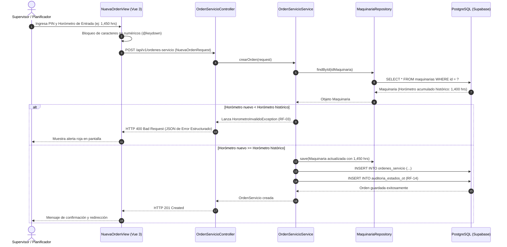
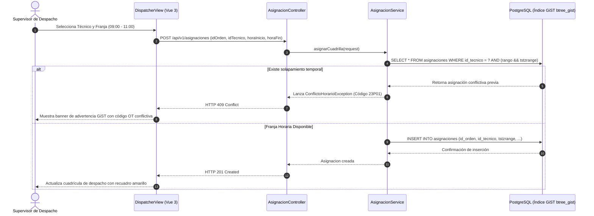
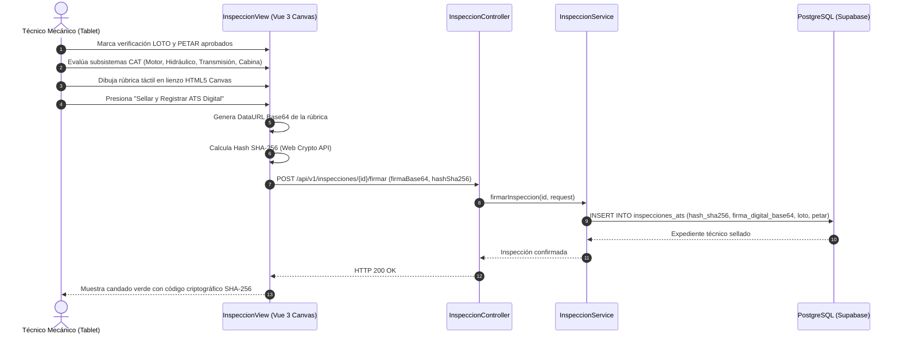

# Diagramas de Secuencia y Arquitectura Operativa - ServTech 2026
**Autor:** Draacoo12 - Juan Zamata (QA & Arquitectura de Software)

---

## 1. Diagrama de Secuencia: Validación de Horómetro Ascendente (RF-02 / RF-03)

---

## 2. Diagrama de Secuencia: Asignación de Franjas Horarias con Control GiST (CU-03 / RF-04)

---

## 3. Diagrama de Secuencia: Checklist Digital ATS y Sellado Criptográfico SHA-256 (RF-08 / RF-09)

